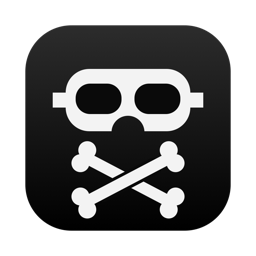
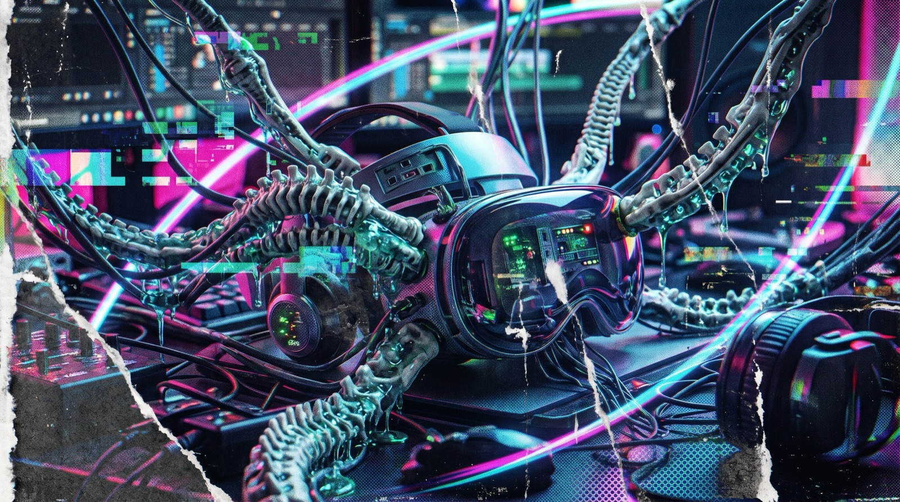
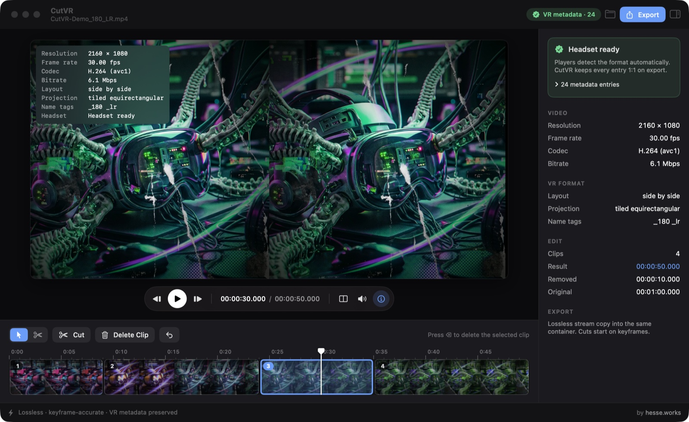
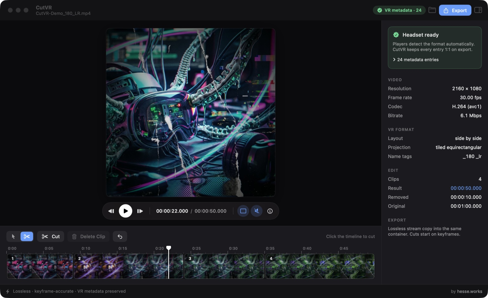
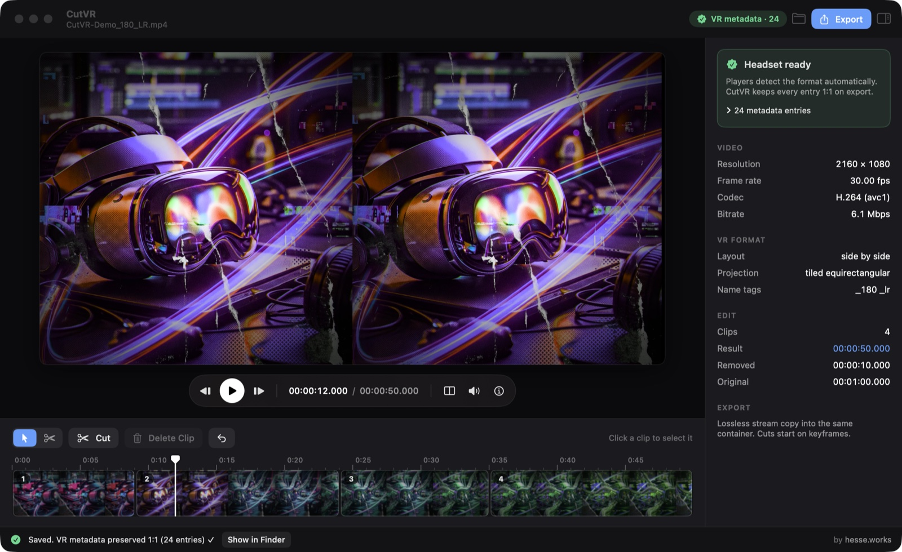
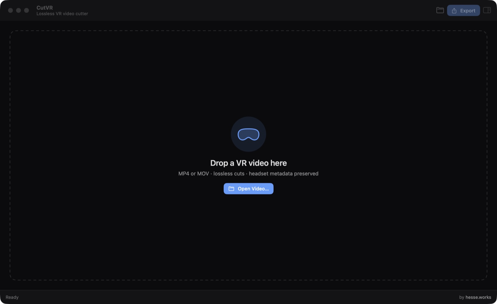

<p align="center">
  
</p>

<h1 align="center">CutVR</h1>

<p align="center">
  <b>Cut VR video in seconds. No re-encoding. No lost headset metadata.</b><br>
  A tiny, fast, native macOS editor for 180° / 360° and stereoscopic VR video.
</p>

<p align="center">
  
</p>

<p align="center">
  
  
  
  
  
  <a href="LICENSE"></a>
</p>

<p align="center">
  
  
  
  
  
</p>

<p align="center">
  
  
  
  
  
  
</p>

<p align="center">
  
  
  
  
</p>

---

## Why CutVR?

You shot an 8K VR video. You only want to trim the start and cut out a few dull minutes.
Most editors make you **re-render the whole thing**. That takes hours and costs quality.
Then the headset shows the video **flat and doubled**, because the editor dropped the VR metadata.

CutVR fixes both:

- ⚡ **Instant.** Exports run at disk speed. Cutting 30 seconds from a 13 GB 8K file takes about **1.5 s**. Joining four parts takes about **4.5 s**.
- 🎯 **Lossless.** Not a single frame is re-encoded. You get exactly the pixels you recorded.
- 🥽 **Headset-ready.** Projection, stereo layout and spherical tags come out **byte for byte** as they went in, and CutVR checks the result after every export.
- 🪶 **Dead simple.** Cut, delete, export. That's the whole workflow.

## See it in action

<p align="center">
  
  <br><sub>Big preview, one floating playback bar, a timeline with a time ruler, and an inspector that tells you at a glance whether the headset will recognise the video.</sub>
</p>

<table>
  <tr>
    <td width="50%" align="center">
      
      <br><sub><b>Single view & scissors.</b> One clean picture instead of two, the scissors tool for cutting right on the timeline, preview muted.</sub>
    </td>
    <td width="50%" align="center">
      
      <br><sub><b>Verified export.</b> Every VR tag is checked after export. A green ✓ in the status bar means the headset sees exactly what it saw before.</sub>
    </td>
  </tr>
</table>

<p align="center">
  
  <br><sub>Start by dropping a video onto the window.</sub>
</p>

<sub>Screenshots use a neutral demo clip (2160×1080, 180° side-by-side with embedded VR metadata).</sub>

## How it works: three moves

| | |
|---|---|
| ✂️ **Cut** | Press **C** to cut at the playhead, or take the scissors (**B**) and click the timeline wherever you need a cut. |
| 🗑️ **Delete** | Click a clip with the select tool (**V**) and press **⌫**. The rest closes up and the timeline always shows the final video. |
| 📤 **Export** | Press **⌘S**. Done. You get one clean file with every VR parameter intact. |

Changed your mind? **⌘Z**.

## Features

- **Scissors and clip workflow.** Cut anywhere, delete any clip, and the remaining clips are joined automatically (ripple delete).
- **Live preview of the result.** Playback skips deleted parts, so you see exactly what you'll export.
- **Single view (E).** Stereo video shows one eye only, one clean picture instead of two squeezed ones. Side-by-side and top-bottom are detected from the metadata, the file name or the frame shape.
- **Mute (M).** Silence the preview while you edit. CutVR remembers the setting.
- **Inspector (I).** A side panel with the headset status, video details, VR format and edit summary. If the file has no VR metadata, it tells you what to do about it.
- **Headset parameter overlay (H).** Resolution, frame rate, codec, bitrate, stereo layout, projection, file-name VR tags, and whether the headset will detect the format by itself.
- **Add missing VR metadata.** Some files lost their VR metadata on the way (ffmpeg drops it easily), so headsets show them flat. Pick the format in the inspector (180°/360°, side-by-side, top-bottom or mono) and CutVR writes standard Google Spherical V2 boxes (`st3d` + `sv3d`) into the export. It also suggests a name such as `_180_LR` for players that read file names. Nothing is re-encoded.
- **VR metadata check.** A badge shows at a glance whether the file carries embedded VR metadata. After export, a ✓ confirms that nothing was lost.
- **Keyframe-accurate cuts.** Stream copy can only start a clip on a keyframe, so CutVR snaps every cut there and moves the playhead to it. What you see is what you get.
- **Smart file names.** Output is `EDIT_<original name>`, so tags like `_180_LR` or `_3dh` that players read from the name stay intact.
- **Dark, distraction-free UI** in the style of macOS pro apps: a large preview, a floating playback bar, a timeline with a time ruler, and drag & drop.
- **Scriptable.** Runs headless from the command line too.

## What metadata is preserved

| Standard | Boxes | Used by |
|---|---|---|
| Google Spherical Video V2 | `st3d`, `sv3d` (`proj`, `equi`, `cbmp`) | YouTube VR, Meta Quest players, Skybox, DeoVR, HereSphere |
| Google Spherical Video V1 | `uuid` (GSpherical XML) | Older players and cameras |
| Apple spatial / immersive | `vexu`, `hfov` | Apple Vision Pro |
| QuickTime user data | title, author, description, thumbnail | Finder, players, libraries |
| File-name tags | `_180`, `_360`, `_LR`, `_TB`, `_SBS`, `_3dh`, `_fisheye`… | DeoVR, HereSphere, Skybox, Pigasus… |

> **Why not just use FFmpeg?** Because `ffmpeg -c copy` alone silently breaks VR files. Into `.mov` it drops `st3d`/`sv3d` entirely. Into `.mp4` it adds a `vexu` box that overrides the stereo mode, so readers see it as "unspecified". The Google V1 tag is always lost. CutVR lets FFmpeg do the fast cutting, then writes the source's VR boxes back byte for byte.

## Download

1. Download **[CutVR.dmg](https://github.com/Hessevalentino/CutVR/releases/latest/download/CutVR.dmg)** from the [latest release](https://github.com/Hessevalentino/CutVR/releases/latest). It is a universal app for Apple Silicon and Intel. Prefer a zip? **[CutVR.zip](https://github.com/Hessevalentino/CutVR/releases/latest/download/CutVR.zip)** is there too.
2. Open the DMG and drag **CutVR** onto the **Applications** folder next to it.
3. Install the two free helpers CutVR uses:

   ```sh
   brew install ffmpeg exiftool
   ```

CutVR is signed with an Apple Developer ID and notarized by Apple, so it opens like any other Mac app, with no security warnings.

Requires macOS 15 or newer.

## Updates

CutVR keeps itself up to date. Every new version is signed, notarized and published as a [release](https://github.com/Hessevalentino/CutVR/releases).

- At launch, CutVR checks GitHub. When a newer version exists, an **Update** button appears in the top bar.
- You can also check at any time with **CutVR → Check for Updates…**
- One click downloads the new version, verifies its code signature, replaces the app and relaunches it. Your edits are not affected, but finish running exports first.

Versions are numbered `1.0.<build>`, where the build number grows with every commit.

## Build from source

```sh
git clone https://github.com/Hessevalentino/CutVR.git
cd CutVR
./build.sh            # → dist/CutVR.app
open dist/CutVR.app
```

Needs Xcode or the Command Line Tools (Swift 6), plus `brew install ffmpeg exiftool`. The build produces a universal binary.

## Keyboard shortcuts

| Key | Action |
|---|---|
| **V** / **B** | Select tool / scissors tool |
| **C** | Cut at the playhead |
| **⌫** | Delete the selected clip |
| **⌘Z** | Undo |
| **Space** | Play / pause |
| **←** / **→** | Previous / next frame |
| **E** | Single view: show one eye of stereo video |
| **M** | Mute / unmute the preview |
| **H** | Toggle the headset parameter overlay |
| **I** | Show or hide the inspector |
| **⌘O** | Open video |
| **⌘S** | Export |

## Command line

```sh
dist/CutVR.app/Contents/MacOS/CutVR --cut <source> <dest> <start-end> [<start-end> …]

# keep 0–30 s and 120–150 s, joined into one file
dist/CutVR.app/Contents/MacOS/CutVR --cut in.mp4 out.mp4 0-30 120.02-150
```

Times are in seconds, and parts are joined in the given order.

Add `--vr <format>` to write VR metadata into a file that has none: `sbs180`, `tb180`, `mono180`, `sbs360`, `tb360` or `mono360`.

```sh
dist/CutVR.app/Contents/MacOS/CutVR --vr sbs180 --cut in.mp4 out_180_LR.mp4 0-60
```

## Under the hood

1. **Cut.** Each kept clip is extracted with `ffmpeg -ss … -t … -c copy`, with no decoding and no encoding.
2. **Join.** Multiple clips are joined with FFmpeg's concat demuxer. CutVR cuts each part separately first, because using concat's `inpoint`/`outpoint` directly on the source loses about 1 s of video per join on files interleaved in 1 s chunks.
3. **Restore VR boxes.** `VRBoxes.swift` parses the MP4/MOV box tree and replaces the output's VR boxes with exact copies from the source. Only the `moov` header is rewritten, and the media data is never touched.
4. **Restore user data.** ExifTool copies title, author, thumbnail and other tags.
5. **Verify.** The VR metadata of source and output are compared with both ffprobe and ExifTool, and the result is shown in the app.

## Good to know

- Cuts snap **back** to the nearest keyframe, usually less than 0.5 s away. That is the price of lossless editing.
- Exporting several clips needs free disk space for about **twice the result size** while it runs. Temporary parts sit next to the output and are deleted afterwards.
- Best results with `.mp4` and `.mov`. Other containers are cut losslessly too, but the VR box restoration step only applies to MP4/MOV.
- HEVC tagged `hev1` (common in 8K VR exports), which macOS normally refuses to play, previews fine. CutVR patches the tag in memory for the preview only, and the file and the export stay untouched.
- If your source has **no embedded VR metadata**, the inspector says so and lets you choose the format to write on export. Existing metadata is never overwritten, it is always copied 1:1.

## Project layout

```
Sources/CutVR/
  App.swift           app entry, About panel, menu, command-line mode
  EditorModel.swift   clips, cutting, playback mapping, export
  Views.swift         main window: toolbar, viewer, edit bar, inspector, status bar
  TimelineView.swift  clip timeline with scissors tool
  PreviewViews.swift  video preview and headset overlay
  Tools.swift         ffmpeg/exiftool runner, VR probe, exporter
  VRBoxes.swift       byte-exact MP4/MOV VR box transfer
  PatchedAsset.swift  in-memory hev1 → hvc1 patch so macOS can preview such HEVC
  Updater.swift       self-update from GitHub Releases
Icon/make_icon.swift  generates the app icon
build.sh              builds dist/CutVR.app (universal, versioned)
release-signed.sh     signs, notarizes and (with --publish) releases CutVR.dmg and CutVR.zip
.github/workflows/    checks that every push builds
```

## License

[MIT](LICENSE) © Valentino Hesse

<p align="center">
  Made by <a href="https://hesse.works"><b>hesse.works</b></a>
</p>
